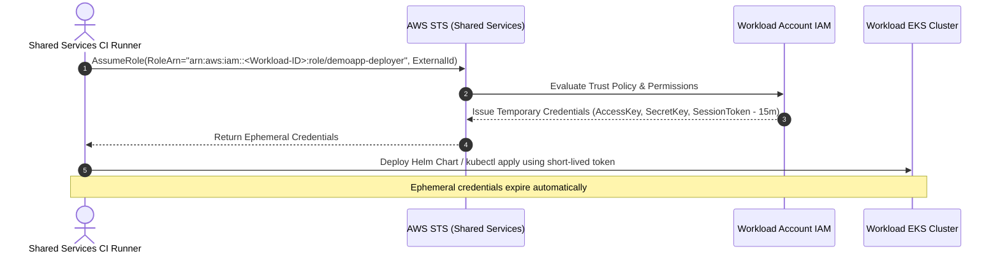

# Part 4: Deploying DemoApp Inside an AWS Landing Zone

---

## 1. Research: AWS Landing Zones & Multi-Account Architecture

### What is an AWS Landing Zone and Why Split Work Across Accounts?
An **AWS Landing Zone** is a well-architected, automated multi-account AWS environment configured according to security, compliance, and operational best practices. Rather than deploying all workloads into a single AWS account, an enterprise utilizes **AWS Organizations** and tools like **AWS Control Tower** or **Landing Zone Accelerator (LZA)** to provision separate accounts for distinct functions, teams, and lifecycle stages.

Organizations separate workloads across accounts for several critical reasons:
1. **Blast Radius Isolation & Security:** AWS accounts serve as the strongest isolation boundary in AWS. If an application in a workload account is compromised or misconfigured, the attacker cannot pivot to the organization's billing, core networking, or other applications.
2. **Quota & Throttling Limits:** AWS service limits (e.g., API request limits, VPC/ENI maximums, Route 53 queries) are enforced per account. Separating accounts prevents "noisy neighbors" from degrading other business services.
3. **Autonomous Access & Least Privilege:** Development teams are granted scoped administrator rights within their development account without endangering shared production infrastructure, central networking, or audit logs.
4. **FinOps & Cost Allocation:** AWS billing and Cost and Usage Reports (CUR) natively slice costs by AWS Account ID, allowing instant financial clarity and attribution.
5. **Centralized Governance & Guardrails:** Organization-level **Service Control Policies (SCPs)** enforce non-bypassable rules (e.g., preventing disabling CloudTrail, disallowing regions outside approved territories, or requiring mandatory tags) across all member accounts.

### Expected Account Types in an Enterprise Landing Zone
* **Management (Root) Account:** The primary account for billing consolidation, organizational hierarchy, Service Control Policies (SCPs), and AWS Control Tower management. No application workloads run here.
* **Log Archive Account:** A tamper-resistant, immutable repository where Amazon S3 buckets store centralized CloudTrail audit logs, VPC Flow Logs, and configuration history from all accounts. Access is strictly locked down.
* **Security & Audit Account:** Centralized security hub hosting tools such as AWS Security Hub, Amazon GuardDuty, AWS IAM Identity Center (SSO), and incident response tooling. Security teams inspect the organization from here.
* **Network (Core Network) Account:** Manages centralized edge ingress (CloudFront, AWS WAF, public ALBs) and inter-account transit (AWS Transit Gateway, Direct Connect, VPN connections, and centralized internet egress via NAT Gateways/Firewalls).
* **Shared Services / Tooling Account:** Hosts shared operational tools, CI/CD runners (self-hosted GitHub Actions runners, Jenkins), artifact repositories, container registries, and internal DNS/monitoring services.
* **Workload Accounts (Dev / Staging / Prod):** Isolated accounts dedicated to a single product or service (e.g., our `demoapp` Workload Account) holding the VPC, EKS cluster, and application data.

---

## 2. Placement Diagram & Request Flow

### Architecture Diagram
Below is the request flow and resource placement across the multi-account Landing Zone:

```mermaid
flowchart TD
    subgraph Client ["External Client"]
        Browser["User Browser"]
    end

    subgraph Internet ["Public Internet"]
        DNS["Route 53 Public DNS\n(demoapp.com)"]
    end

    subgraph CentralNetworkAccount ["Central Network Account"]
        WAF["AWS WAF & CloudFront"]
        PublicALB["Central Ingress ALB\n(ACM TLS: *.demoapp.com)"]
        TGW["AWS Transit Gateway (TGW)\nRoute Tables & Attachments"]
        CentralNAT["Central Egress NAT GW / Firewall"]
    end

    subgraph WorkloadAccount ["Workload Account (demoapp)"]
        WorkloadVPC["Workload VPC (Private Only)\nNo IGW / No Local NAT"]
        VPCE["VPC Endpoints\n(ECR API, ECR DKR, S3 Gateway)"]
        
        subgraph EKSCluster ["EKS Cluster (demoapp-cluster)"]
            Node1["Worker Node 1\n(t3.small - Private)"]
            Node2["Worker Node 2\n(t3.small - Private)"]
            Pod1["Pod: demoapp\n(:3000)"]
            Pod2["Pod: demoapp\n(:3000)"]
            Svc["ClusterIP Service\n(:80 -> :3000)"]
        end
    end

    subgraph SharedServicesAccount ["Shared Services Account"]
        CIRunner["CI/CD Runner\n(GitHub Actions / Jenkins)"]
    end

    %% Ingress Flow
    Browser -->|1. Resolve demoapp.com| DNS
    Browser -->|2. HTTPS :443 GET /| WAF
    WAF --> PublicALB
    PublicALB -->|3. Terminate TLS & Inspect| PublicALB
    PublicALB -->|4. Forward across TGW peering| TGW
    TGW -->|5. Deliver to Pod IP| Pod1
    TGW -->|5. Deliver to Pod IP| Pod2
    Svc -.-> Pod1
    Svc -.-> Pod2

    %% Egress & Tooling Flow
    Node1 -->|Pulls base images privately| VPCE
    Node2 -->|Outbound internet via TGW| TGW
    TGW -->|Centralized egress| CentralNAT
    CentralNAT -->|6. Controlled Egress| Internet

    %% Deployment Flow
    CIRunner -->|AssumeRole (OIDC/STS)| WorkloadAccount
```

### Request Flow & Design Assumptions
1. **DNS Resolution & Entry:** The user navigates to `https://demoapp.com`. The public Route 53 zone hosted in the Central Network Account resolves the DNS query to the Central Ingress Application Load Balancer (ALB).
2. **Edge Security & TLS Termination:** The request hits AWS WAF (protecting against DDoS and OWASP Top 10 vulnerabilities). The Central ALB terminates TLS using an **AWS Certificate Manager (ACM)** certificate issued for `demoapp.com`.
3. **Inter-Account Routing via Transit Gateway:** The Central ALB forwards the decrypted HTTP traffic into the Transit Gateway (TGW) attachment. TGW route tables route the packet into the Workload VPC attachment.
4. **Direct Pod Ingestion:** Because the AWS Load Balancer Controller uses IP-target mode (`alb.ingress.kubernetes.io/target-type: ip`), traffic traverses the TGW directly to the private IP address of the target Pod running in the EKS node group.
5. **Private Subnets & Private Egress:** The Workload VPC contains private subnets only. Any outbound internet traffic (e.g., OS updates) routes through TGW to the central egress NAT Gateway in the Network Account. ECR and S3 traffic stays entirely inside the AWS backbone via local VPC Endpoints.

---

## 3. Network Changes: Standalone VPC vs. Landing Zone Workload VPC

### Comparison Table

| Architecture Dimension | Part 1 Standalone VPC | Part 4 Landing Zone Workload VPC | Architectural Reason |
|---|---|---|---|
| **Subnet Configuration** | Public and Private Subnets across 3 AZs | **Private Subnets only** | Eliminates internet exposure; no workload component directly touches the internet. |
| **Internet Gateway (IGW)** | Dedicated IGW attached | **No IGW attached** | Organizational security policy strictly forbids IGWs in workload accounts. |
| **NAT Gateway** | Dedicated NAT Gateway in public subnet | **No local NAT Gateway** (Traffic routes to Transit Gateway) | Massive cost reduction: eliminates \$33/month per VPC NAT fee and centralizes traffic filtering. |
| **CIDR Allocation** | Arbitrary default `10.0.0.0/16` | **Centrally allocated (e.g., `10.50.0.0/20`)** | Prevents overlapping subnets when peering multiple VPCs to the Transit Gateway. |
| **Container Image Pulls** | Pulls from public internet via NAT | **VPC Endpoints (PrivateLink)** | Keeps image pull traffic private, fast, and free of NAT data processing charges. |
| **Ingress Path** | Local ALB in Workload public subnets | **Central Ingress ALB** in Network Account | Centralized TLS, WAF policies, and domain management. |

### Code Implementation (Bonus)
In our repository, these best practices are already implemented in [`terraform/vpc.tf`](file:///Users/shon/Home_Task/terraform/vpc.tf):
1. **No Public IPs on Worker Nodes:** `map_public_ip_on_launch = false` ensures that nodes deployed into subnets never receive public IPv4 addresses.
2. **Private VPC Endpoints for ECR & S3:**
   * `aws_vpc_endpoint.s3` (Gateway Endpoint) routes S3 layer downloads internally.
   * `aws_vpc_endpoint.ecr_api` and `aws_vpc_endpoint.ecr_dkr` (Interface Endpoints) enable secure Docker image authentication and layer downloads without any internet gateway.

---

## 4. Guardrails & Policy as Code

### Mandatory Tags Implementation
The three organizational tags (`environment`, `owner`, `cost_center`) are automatically applied to every resource via Terraform's AWS Provider `default_tags` block in [`terraform/providers.tf`](file:///Users/shon/Home_Task/terraform/providers.tf):

```hcl
provider "aws" {
  region = var.region

  default_tags {
    tags = {
      environment = var.environment
      owner       = var.owner
      cost_center = var.cost_center
      Project     = "demoapp"
      ManagedBy   = "Terraform"
    }
  }
}
```

### What Happens When a Tag is Missing & SCP Rejects It?
If a developer introduces a resource without the required tags and an AWS Service Control Policy (SCP) is active:
1. When `terraform apply` executes against AWS, the AWS API call returns an **`AccessDeniedException`** (Explicit Deny by SCP).
2. The pipeline crashes midway through provisioning. This leaves Terraform state in an inconsistent, half-created state requiring manual state unlocking and cleanup.
3. **The Solution (Shift-Left Policy as Code):** By running a Policy-as-Code tool in the pull request validation stage, missing tags are detected and blocked *before* any AWS API call or `terraform apply` is attempted.

### Policy as Code Selection: Checkov
* **Tool Selected:** **Checkov** (Bridgecrew / Prisma Cloud).
* **Why Checkov?**
  * Native support for Terraform HCL, Kubernetes YAML, and Helm charts in a single CLI.
  * Over 1,000 built-in security best-practice policies (e.g., checking for unencrypted EBS, public security groups).
  * Simple YAML-based or Python-based custom policy creation for enforcing required organizational tags.
* **Pipeline Integration:**
  Checkov is wired directly into the pull request gate in [`.github/workflows/terraform.yml`](file:///Users/shon/Home_Task/.github/workflows/terraform.yml) as an active hard gate (`soft_fail: false`). Acknowledged architectural baselines (such as semantic module versions and standard VPC node egress) are explicitly documented via `skip_check`:
  ```yaml
  - name: Run Checkov Policy-as-Code Scanner
    uses: bridgecrewio/checkov-action@master
    with:
      framework: terraform
      directory: terraform
      soft_fail: false # Hard gate: fails CI if security guardrails or required tags are violated
      skip_check: CKV_TF_1,CKV_AWS_382,CKV_AWS_23,CKV_AWS_355,CKV_AWS_136 # Documented baseline exceptions
      output_format: cli
  ```

---

## 5. FinOps & Cost Optimization

### Monthly Cost Estimate (Parts 1–3 Standalone Setup)
*Estimates based on AWS Pricing Calculator in `us-east-1`:*

| Resource Component | Specification | Unit Cost | Monthly Total (USD) |
|---|---|---|---|
| **EKS Control Plane** | 1 Managed Cluster | \$0.10 / hour | **\$73.00** |
| **Worker Nodes (EC2)** | 2x `t3.small` (2 vCPU, 2GB RAM) | \$0.0208 / hour / node | **\$30.37** |
| **EBS Storage** | 20GB `gp3` per node (40GB total) | \$0.08 / GB-month | **\$3.20** |
| **Application Load Balancer** | 1 ALB (~15 LCU-hours/day) | \$0.0225/hr + \$0.008/LCU | **\$22.20** |
| **NAT Gateway (Standalone)** | 1 NAT Gateway + 20 GB egress | \$0.045/hr + \$0.045/GB | **\$33.75** |
| **ECR Storage & Data Transfer** | 15 images (~5 GB) | \$0.10 / GB | **\$0.50** |
| **Total Estimated Monthly Cost** | | | **\$163.02** |

---

### FinOps Analysis

#### 1. Top 3 Changes to Cut Dev Environment Costs
1. **Spot Instances for Worker Nodes:** Transitioning dev node groups to EC2 Spot instances yields up to 70–80% savings on compute (reducing EC2 cost to ~\$7.50/mo).
2. **Scale-to-Zero Outside Business Hours:** Using Kubernetes KEDA or AWS Lambda/EventBridge to scale node groups and replica sets to 0 between 19:00 and 07:00 and on weekends (reducing uptime from 730 to ~220 hours/month $\rightarrow$ saves ~70% on compute and NAT).
3. **Eliminate Dedicated NAT Gateway:** In a Landing Zone, routing egress through the shared Transit Gateway egress eliminates the standalone \$33.75/month NAT Gateway fee.

#### 2. Which Changes Would You Strictly Refuse in Production, and Why?
* **Refuse 100% Spot Instances:** Spot instances can be reclaimed by AWS with a 2-minute termination warning. In production, at least 2 baseline nodes must be On-Demand (or Savings Plans/Reserved) to guarantee continuous availability.
* **Refuse Single-AZ or Single NAT Gateway:** Single-AZ architectures introduce a Single Point of Failure (SPOF). Production requires multi-AZ node distribution and redundant NAT gateways.
* **Refuse Scale-to-Zero Schedules:** Production systems must remain highly available 24/7/365 to handle customer transactions, automated background jobs, and health checks.

#### 3. How Mandatory Tags Help Finance Teams
* **Cost Center Attribution:** Finance maps the `cost_center` tag directly to accounting general ledgers, automatically charging infrastructure costs to the responsible business unit.
* **Environment Slicing:** Filtering by `environment: dev` vs `environment: prod` reveals dev waste (e.g., untagged sandbox clusters left running over weekends).
* **Owner Accountability:** When an unexpected cost spike occurs, the `owner` tag instantly identifies who to notify for rightsizing or remediation.

---

## 6. Pipeline Credentials Across Accounts

### Secure Cross-Account Deployment Workflow
When CI/CD runners live in the **Shared Services Account** but need to deploy into the **Workload Account**, storing long-lived AWS IAM access keys (`AKIA...`) in GitHub Secrets is a major security vulnerability.

Instead, we implement **Cross-Account IAM Role Assumption (STS AssumeRole)**:



### Implementation Details (Bonus)
The cross-account IAM role is fully implemented in [`terraform/cross-account-role.tf`](file:///Users/shon/Home_Task/terraform/cross-account-role.tf):
1. **Strict Trust Policy:** Only permits the designated CI Runner role from the Shared Services Account (`var.shared_services_account_id`) to assume the role.
2. **External ID Enforcement:** Includes `sts:ExternalId` as a defense-in-depth condition against the confused deputy problem.
3. **Least-Privilege Scoping:** Permissions are strictly confined to:
   * EKS Cluster Describe (`eks:DescribeCluster`)
   * ECR image pull/push (`ecr:GetDownloadUrlForLayer`, `ecr:PutImage`)
   * No access to billing, IAM modification, or network deletion.

---

## 7. How I Worked: Verification & AI Reflection

### Sources & References
* [AWS Control Tower Documentation](https://docs.aws.amazon.com/controltower/)
* [AWS Well-Architected Framework - Reliability & Security Pillars](https://aws.amazon.com/architecture/well-architected/)
* [AWS Whitepaper: Organizing Your AWS Environment Using Multiple Accounts](https://docs.aws.amazon.com/whitepapers/latest/organizing-your-aws-environment/organizing-your-aws-environment.html)
* [AWS EKS Best Practices Guide: Networking and Security](https://aws.github.io/aws-eks-best-practices/)
* [HashiCorp Terraform AWS Provider Documentation](https://registry.terraform.io/providers/hashicorp/aws/latest/docs)

### Tooling Used
* **Terraform v1.9.0**: Modular IaC development and validation (`terraform fmt`, `terraform validate`).
* **Helm v3.15.0**: Kubernetes templating and chart linting (`helm lint`, `helm template`).
* **Node.js v18 & Jasmine**: Automated testing of application primes calculator.

### AI Reflection & Verification
* **What I Prompted:** I asked AI to propose an architecture for multi-account Landing Zone ingress and how private EKS nodes pull images without an IGW.
* **What I Kept:** The multi-tier account breakdown (Network, Shared Services, Workload) and the pattern of Transit Gateway routing.
* **What AI Got Wrong / What I Double-Checked:**
  * *AI Misconception:* The AI initially suggested creating Route 53 private hosted zone associations directly from the Workload account to the Central Network ALB without noting that ALB target groups in another account require either IP-target mode over Transit Gateway or AWS PrivateLink Ingress chaining.
  * *Verification against Docs:* I verified in the AWS EKS and AWS Load Balancer Controller official documentation that `alb.ingress.kubernetes.io/target-type: ip` allows cross-VPC and cross-account target registration as long as private IP subnets are routable across AWS Transit Gateway.

