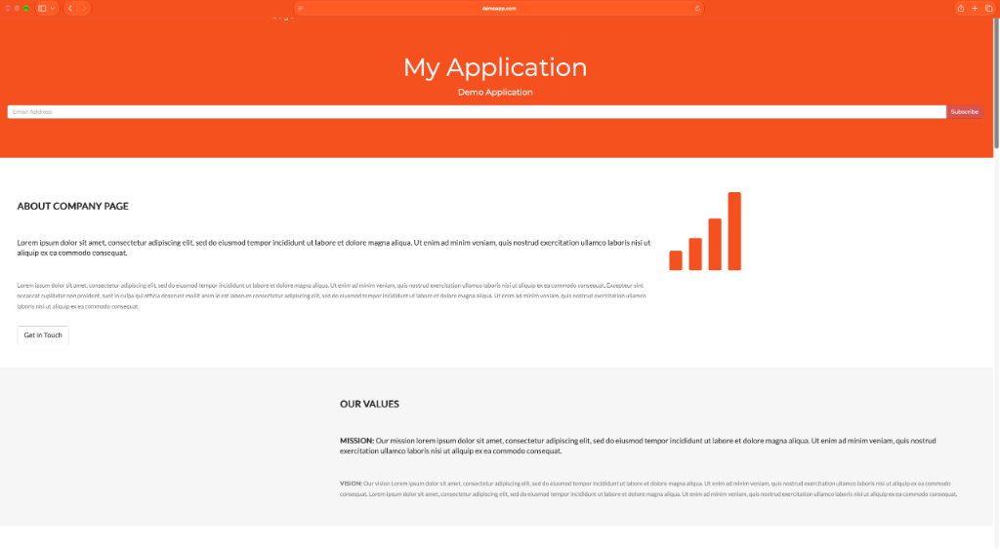

# DevOps Home Task: EKS, GitOps, CI/CD & Kubernetes Deployment

This repository contains the complete implementation for the DevOps Home Exercise (Parts 1 to 3), encompassing Infrastructure as Code (Terraform), Containerization, Helm packaging, and GitHub Actions CI/CD pipelines.

---

## 📁 Repository Structure

```text
├── .github/
│   └── workflows/
│       ├── terraform.yml       # Part 1: Automated Terraform linting, Checkov scan & deployment
│       └── app-ci-cd.yml       # Part 3: Test, build, Trivy scan, ECR push & Helm deploy
├── app/
│   ├── Dockerfile              # Multi-stage, non-root production Dockerfile
│   ├── primes.js               # Core prime calculator logic
│   ├── server.js               # Express HTTP server
│   ├── index.html              # Web UI
│   └── spec/                   # Jasmine unit test specifications
├── helm/
│   └── demoapp/                # Part 2: Production-grade Helm chart
│       ├── Chart.yaml
│       ├── values.yaml
│       └── templates/          # Deployment, Service, Ingress (ALB), HPA, ServiceAccount
├── terraform/                  # Part 1: Modular Infrastructure as Code
│   ├── providers.tf            # AWS, Helm, Kubernetes providers
│   ├── variables.tf            # Input variables & cluster configuration
│   ├── vpc.tf                  # Multi-AZ VPC + NAT Gateway
│   ├── eks.tf                  # AWS EKS (v1.31) with AL2023 Managed Node Groups
│   ├── ecr.tf                  # ECR repository with scan-on-push & lifecycle expiration
│   ├── alb-controller.tf       # AWS Load Balancer Controller Helm release & Pod Identity
│   ├── alb-controller-policy.json
│   ├── github-oidc.tf          # Keyless GitHub Actions OIDC Provider & IAM Role
│   ├── acm.tf                  # Route 53 zone & ACM TLS certificate (demoapp.com)
│   └── outputs.tf              # Infrastructure endpoints and ARNs
├── docs/
│   └── GIT_STRATEGY.md         # Part 2: Git branching strategy and repository policies
└── INSTRUCTIONS.md             # Original exercise instructions and prompt guidelines
```

---

## 🚀 Overview of Parts

### Part 1: Infrastructure as Code (Terraform)
* **VPC:** Multi-AZ (3 AZs) with public subnets for ingress/NAT and private subnets for compute. Nodes never receive public IPs.
* **EKS Cluster:** Kubernetes v1.31 running Amazon Linux 2023 (`AL2023_x86_64_STANDARD`) on cost-efficient `t3.small` nodes with Prefix Delegation enabled for maximum pod density.
* **Ingress Controller:** AWS Load Balancer Controller installed via Helm with EKS Pod Identity Association.
* **Security & Auth:** Keyless AWS IAM OIDC federation for GitHub Actions (no permanent AWS credentials).
* **CI/CD:** [`.github/workflows/terraform.yml`](.github/workflows/terraform.yml) automatically runs format checks, validation, and Checkov policy scanning.

### Part 2: Application Containerization & Helm Chart
* **Containerization:** Multi-stage `Dockerfile` with `dumb-init` process supervisor, running as a non-root user (`node`).
* **Helm Chart:** Fully templated under `helm/demoapp` with liveness/readiness probes, resource limits/requests, HPA autoscaling, and ALB Ingress configured for `demoapp.com` with TLS termination via ACM.
* **Git Architecture:** Detailed in [`docs/GIT_STRATEGY.md`](docs/GIT_STRATEGY.md) with Trunk-Based branching and protected `main` branch policies.
* **Website Verification:** Application live on AWS EKS, exposed via AWS ALB with TLS termination:

  

### Part 3: Continuous Integration & Deployment Pipeline
* Pipeline definition in [`.github/workflows/app-ci-cd.yml`](.github/workflows/app-ci-cd.yml) consists of 5 automated stages:
  1. **Unit Tests:** Executes Jasmine test suite (`npm test`).
  2. **Docker Build:** Validates container build via Docker Buildx.
  3. **Security Vulnerability Scan:** Aqua Trivy scans the container image, failing the build on unfixed `CRITICAL` or `HIGH` vulnerabilities.
  4. **ECR Push (Main only):** Authenticates via OIDC and pushes immutable tagged images (`1.0.0-<git-sha>`).
  5. **EKS Deploy (Main only):** Deploys the application to the cluster using Helm with zero downtime.

---

## 🛠️ Local Verification Commands

Validate the codebase locally without cloud deployment:

```bash
# 1. Run Application Unit Tests
cd app && npm test

# 2. Lint Helm Chart Templates
helm lint helm/demoapp
helm template demoapp helm/demoapp

# 3. Format & Validate Terraform
cd terraform
terraform fmt -check
terraform init -backend=false
terraform validate
```
