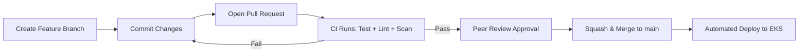

# Git Branching Strategy & Architecture

## Overview
This document outlines the Git branching strategy and repository policies adopted for the `demoapp` project, designed to maintain stability, enforce security and quality gates, and facilitate continuous delivery.

---

## Branching Model: Trunk-Based Development with Environment Branches

We employ a modified **Trunk-Based / GitHub Flow** model with short-lived feature branches and clear deployment triggers.

```
  feature/add-caching ───●───●───┐
                                 │ (PR with required reviews & CI checks)
  main (Production) ─────────────▼────────●──────────────────────────────
                                          │ (Automated SemVer release)
                                          ▼
                                     Tag: v1.0.1
```

### 1. `main` Branch (Production)
* **Purpose:** Represents production-ready code. Every commit on `main` is deployable.
* **Direct Commits:** **Strictly Prohibited** via GitHub Branch Protection Rules.
* **Deployment Trigger:** Triggers automated image build, Trivy security scan, ECR push, and Helm deployment.

### 2. Feature / Fix Branches (`feature/*`, `fix/*`, `chore/*`)
* **Naming Conventions:**
  * `feature/<short-description>`: New functionality (e.g., `feature/add-health-check`)
  * `fix/<bug-description>`: Bug fixes (e.g., `fix/prime-calculation-edge-case`)
  * `infra/<component>`: Infrastructure changes (e.g., `infra/update-vpc-subnets`)
* **Lifespan:** Short-lived (1–2 days maximum) to minimize merge conflicts.

---

## Branch Protection Rules (Enforced on `main`)

To ensure quality and compliance, the following branch protection settings are configured:

1. **Require Pull Request Reviews:**
   * At least 1 approving review from authorized code owners before merging.
   * Dismiss stale reviews when new commits are pushed.
   * Require review from Code Owners (`CODEOWNERS`).

2. **Require Status Checks to Pass Before Merging:**
   * `validate-and-lint` (Terraform syntax, formatting, and Checkov policy scan).
   * `unit-test` (Node.js Jasmine unit tests).
   * `docker-build-validate` (Dockerfile build verification).
   * `trivy-scan` (Container vulnerability check with zero `CRITICAL` or `HIGH` vulnerabilities).

3. **Require Signed Commits:**
   * All commits must be GPG/SSH-signed to verify author authenticity.

4. **Require Linear History:**
   * Enforce **Squash and Merge** or **Rebase and Merge** to keep Git history clean, readable, and easily reversible.

5. **Do Not Allow Force Pushes or Deletions:**
   * Protects commit history from inadvertent overwrites or loss.

---

## Pull Request Lifecycle & Verification Gates



1. **Local Development:** Developer writes code and runs unit tests (`npm test`) and Helm linting (`helm lint`).
2. **Pull Request Submission:** Developer opens a PR against `main`.
3. **Automated CI Checks:** GitHub Actions executes tests, builds test image, runs Trivy scanner, and verifies Terraform plans.
4. **Peer Review:** Code reviewer verifies logic, architecture, and documentation.
5. **Merge & Continuous Delivery:** Once all checks pass and approval is granted, the PR is merged into `main`, triggering automated release tagging and deployment.

